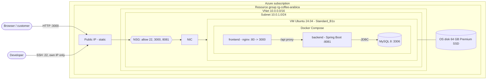

# Architecture – Azure deployment

## Diagram

Provisioned by Terraform (`infra/terraform/`). The containers are started with Docker Compose from `docker-compose.yml`.

## Azure services used

| Service | Resource name | Purpose | Free tier |
| --- | --- | --- | --- |
| Resource group | `rg-coffee-arabica` | Container for all resources; deleting it removes everything | No cost |
| Virtual network | `vnet-coffee-arabica` | Private network `10.0.0.0/16` | No cost |
| Subnet | `snet-coffee-arabica` | `10.0.1.0/24` where the VM connects | No cost |
| Public IP (Standard, static) | `pip-coffee-arabica` | Fixed internet address | Check free allowance |
| Network security group | `nsg-coffee-arabica` | Firewall: SSH from one IP, ports 3000 and 8081 | No cost |
| Network interface | `nic-coffee-arabica` | Connects the VM to subnet and public IP | No cost |
| Linux VM `Standard_B1s` | `vm-coffee-arabica` | Runs Docker and the three containers | 750 h/month, 12 months |
| Managed disk (Premium SSD 64 GB) | OS disk | System disk | 2 disks, 12 months |

## Application components (containers)

| Container | Image | Port | Role |
| --- | --- | --- | --- |
| `coffee-frontend` | nginx serving the React build | 3000 (host) -> 80 | UI, proxies `/api/` to the backend |
| `coffee-backend` | Spring Boot (Java 21) | 8081 | REST API, Spring Security |
| `coffee-db` | `mysql:8.0` | 3306 (internal) | Data, volume `mysql_data` |

## Network rules (NSG)

| Priority | Name | Port | Source |
| --- | --- | --- | --- |
| 100 | allow-ssh | 22 | Your IP (`ssh_allowed_cidr`) |
| 110 | allow-frontend | 3000 | Internet |
| 120 | allow-backend-api | 8081 | Internet |

All other inbound traffic is denied by default.

## Planned (not built yet)

- GitHub Actions pipeline deploying to the VM over SSH (secrets structure: task CAD213-36).
